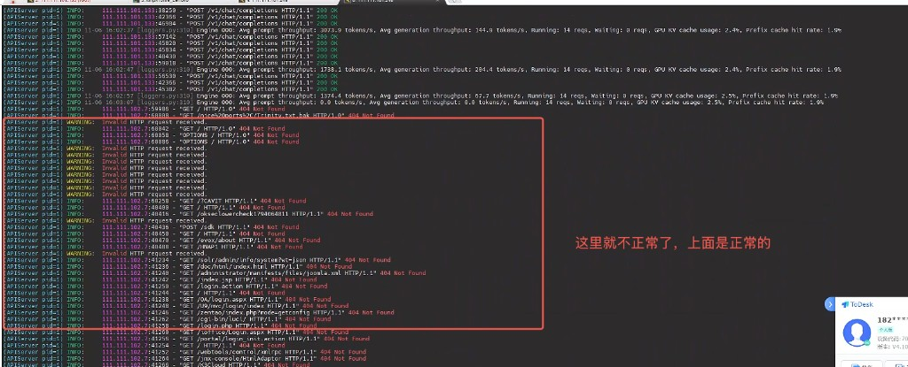
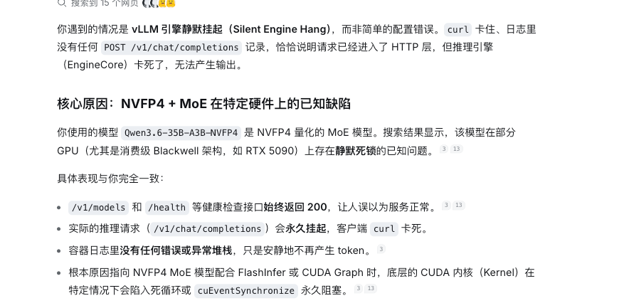

# 讨论报告：Spark DGX 上 Qwen3.6-NVFP4 服务长跑假死（WiNBOT 质控）

> **文档性质**：问题讨论稿（非最终结论 / 非已闭环故障单）  
> **日期**：2026-11-09  
> **范围**：Spark DGX 工作站单机推理服务 + WiNBOT 质控业务负载  
> **模型**：`Qwen3.6-35B-A3B-NVFP4`  
> **推理镜像**：`vllm/vllm-openai:qwen3.6`  
> **当前处置**：暂无稳定根治手段；业务侧以**重启模型服务**恢复  
> **目的**：汇总现象、证据、可能根因与可选路径，供运维 / 研发 / 业务共同讨论决策  

---

## 1. 背景与业务现状

### 1.1 部署概况

| 项 | 内容 |
|---|---|
| 平台 | Spark DGX 工作站 |
| 模型 | `Qwen3.6-35B-A3B-NVFP4`（NVFP4 量化 MoE） |
| 镜像 | `vllm/vllm-openai:qwen3.6` |
| 监听 | `0.0.0.0:8001` |
| 业务方 | WiNBOT 质控系统（山西晋城试点） |

### 1.2 启动参数（当前参考）

```bash
vllm serve /models \
  --host 0.0.0.0 --port 8001 \
  --quantization ascend \
  --max-model-len 262144 \
  --max-num-seqs 12 \
  --max-num-batched-tokens 4096 \
  --gpu-memory-utilization 0.90 \
  --enable-prefix-caching \
  --trust-remote-code \
  --served-model-name qwen3.6 \
  --compilation-config '{"cudagraph_mode":"FULL_DECODE_ONLY"}' \
  --default-chat-template-kwargs '{"enable_thinking": false}' \
  --enable-auto-tool-choice \
  --tool-call-parser qwen3_coder \
  --reasoning-parser qwen3 \
  --additional-config '{"enable_cpu_binding":true, "multistream_overlap_shared_expert": true}'
```

> **讨论备注**：参数中含 `--quantization ascend` 与 `cudagraph_mode=FULL_DECODE_ONLY`。前者命名偏昇腾侧；后者与附图 2 所述「NVFP4 MoE + CUDA Graph / FlashInfer」风险点相关，建议会上核对是否为现网真实生效配置。

### 1.3 质控业务量（近期快照）

**2026-11-05｜山西晋城（WiNBOT）**

- 试点科室：心内科、骨科  
- 质控患者：2114 人（新增 68）  
- 在院病历：27890 份（新增 1065）  
- 归档病历：40025 份（新增 537）  
- 质控问题数：6610；问题病历数：2308 份  

**2026-10-29｜山西晋城（WiNBOT）**

- 试点科室：心内科、骨科  
- 质控患者：2046 人（新增 79）  
- 在院病历：26825 份（新增 785）  
- 归档病历：39488 份（新增 432）  
- 质控问题数：6342；问题病历数：2216 份  

业务特征：**持续批处理 + 长上下文病历文本 + 长时间在线**。这与「跑久了才假死」高度吻合，属于典型长稳压测场景，而非偶发 smoke 失败。

---

## 2. 问题陈述

### 2.1 现象（业务侧）

1. WiNBOT 质控任务长时间运行后，模型服务进入**假死**状态：  
   - 推理请求卡住（客户端 `curl` / 业务调用长时间无响应）  
   - 服务进程往往仍在，并非干净崩溃退出  
2. 目前没有稳定、可自动化的根治手段。  
3. **临时恢复手段**：重启模型服务（容器 / `vllm serve` 进程）。  
4. 业界/社区侧有说法：属 **NVFP4 + MoE 相关系统/引擎缺陷**（见附图 2），健康检查仍可能返回 200，易误判为“服务正常”。

### 2.2 现象（日志侧，附图 1）



**上半段（正常）**

- 来源 IP `111.111.101.133` 的 `POST /v1/chat/completions` 持续 `200 OK`  
- Engine 周期日志显示有吞吐，例如：  
  - Avg prompt throughput：约 1300～3000 tokens/s  
  - Avg generation throughput：约 67～284 tokens/s  
  - Running：约 14；Waiting：0～8  
  - GPU KV cache usage：约 2.4%～2.5%  
  - Prefix cache hit rate：约 1.9%  

**转折点**

- 约 `16:03:07`：仍有 Running=14 / Waiting=8，但 **Avg generation throughput = 0.0 tokens/s**  
  → 队列未清空，生成侧已停转（典型假死前兆）

**下半段（异常，红框标注「这里就不正常了」）**

- 另一源地址 `111.111.102.7` 高频探测/扫描：  
  - 大量 `WARNING: Invalid HTTP request received.`  
  - 大量对非推理路径的 `GET/POST` → `404 Not Found`  
  - 路径特征明显为漏洞扫描（如 `/phpMyAdmin/`、`/HNAP1`、`/solr/admin/...`、`/zentao/...`、`/cgi-bin/luci/` 等）  

> **讨论备注**：附图 1 同时暴露两类问题——① 推理引擎生成吞吐归零；② 服务口对不可信网络暴露并遭扫描。二者可能「同时出现」或「互为放大」，需分开举证，避免把扫描流量直接当成唯一根因。

---

## 3. 已有分析意见（附图 2，待验证）



社区/分析侧将此类问题定性为 **Silent Engine Hang（引擎静默挂死）**，而非简单参数配错：

| 观测点 | 表现 |
|---|---|
| `/v1/models`、`/health` | 仍可能 **HTTP 200**（健康检查不可信） |
| `/v1/chat/completions` | 请求挂起，客户端长时间无返回 |
| 容器日志 | 往往**无明确异常栈**；只是不再产出 token |
| 推测机制 | NVFP4 MoE + FlashInfer / CUDA Graph 路径下，CUDA kernel 死循环或 `cuEventSynchronize` 永久阻塞 |
| 与启动参数相关性 | `cudagraph_mode=FULL_DECODE_ONLY` 可能加重触发概率（待实测对比） |

> **讨论备注**：附图 2 引用场景含消费级 Blackwell（如 RTX 5090）描述；本项目为 Spark DGX，硬件栈不同，**是否同根因需本地复现与版本核对**，不可直接等同结论。

---

## 4. 问题分层（建议讨论框架）

为避免会上把「引擎假死」与「网络安全」混为一谈，建议按三层讨论：

### A. 推理引擎稳定性（主问题）

- **症状**：generation throughput → 0；chat 请求挂死；health 仍可能 200  
- **嫌疑**：NVFP4 MoE + 当前 vLLM 镜像 / CUDA Graph / FlashInfer 组合缺陷  
- **证据缺口**：假死瞬间是否有 GPU Xid、`nvidia-smi` 挂死、`cuda-gdb`/`nsys` 栈、EngineCore 是否可响应  

### B. 服务暴露面与扫描噪声（并发问题）

- **症状**：`111.111.102.7` 大量无效 HTTP / 漏洞路径探测  
- **影响**：占用 APIServer 事件循环、污染日志、可能放大抖动；**不等同于已证明是假死根因**  
- **处置方向**：ACL / 防火墙 / 反代鉴权 / 仅内网或 Tailscale 暴露  

### C. 业务连续性（运维兜底）

- **现状**：人工重启恢复  
- **缺口**：缺少“真正能判定推理可用”的探针（不能只看 `/health`）  
- **目标**：可接受的自动探测 + 受控重启 + 告警，保证 WiNBOT 质控不断档  

---

## 5. 临时与中期可选方案（供评选，尚未落地）

### 5.1 业务兜底（优先可落地）

| # | 方案 | 说明 | 代价 |
|---|---|---|---|
| 1 | **推理级 soak 探针** | 定时真实 `POST /v1/chat/completions`（短 prompt），超时即判假死；勿只依赖 `/health` | 需开发/部署 |
| 2 | **受控自动重启** | 探针失败 → 拉起容器/进程；保留崩溃前后日志 | 有短窗口中断 |
| 3 | **业务侧超时与重试** | WiNBOT 对单次推理设硬超时 + 有限次重试/换队列 | 需业务配合 |
| 4 | **定期预防性重启** | 如每日低峰窗口滚动重启，降低长跑触发概率 | 治标 |

### 5.2 引擎侧缓解（需窗口验证）

| # | 方案 | 目的 | 风险 |
|---|---|---|---|
| A | 关闭或降级 CUDA Graph（对比去掉 / 调整 `FULL_DECODE_ONLY`） | 验证是否与假死相关 | 吞吐可能下降 |
| B | 关闭/调整 FlashInfer 相关路径（若镜像可配） | 验证 kernel 路径 | 需查镜像能力 |
| C | 下调 `max-model-len` / `max-num-seqs` / 批大小 | 降低长稳压力 | 质控吞吐下降 |
| D | 换非 NVFP4 精度或非 MoE 变体（若有业务可接受权重） | 绕开已知缺陷面 | 存储/性能/效果评估 |
| E | 升级/锁定更新版 `vllm-openai:qwen3.6` 或厂商 hotfix | 跟踪上游修复 | 回归成本 |

### 5.3 安全与暴露面（建议并行推进）

1. **禁止公网直暴露** `:8001`；仅办公网 / Tailscale / 网关可达  
2. 网关层加 API Key / mTLS；拒绝非 `/v1/*` 扫描路径  
3. 防火墙对源 IP 白名单（至少业务出口 IP）  
4. 扫描 IP `111.111.102.7` 立即封禁并排查是否同网段误暴露  

---

## 6. 建议的取证清单（下次假死时）

假死发生后、**重启前**尽量保全：

1. `docker logs` / `vllm` 日志完整段（含假死前 30 分钟）  
2. 当时 `nvidia-smi`、`nvidia-smi -q`、dmesg（查 Xid）  
3. 进程栈：`py-spy` / `gdb` / `cuda-gdb`（EngineCore 是否卡在 synchronize）  
4. 区分两类请求：业务 `chat/completions` 是否仍入队；扫描流量占比  
5. 对照实验记录：是否开启 `FULL_DECODE_ONLY`、prefix caching、tool/reasoning parser  
6. 假死前最后一次非零 generation throughput 时间戳与 Running/Waiting 数  

---

## 7. 讨论议题（建议会上拍板）

1. **定性**：按「引擎 Silent Hang」跟进，还是先当「暴露面 + 扫描干扰」处理？或双线并行？  
2. **SLA**：WiNBOT 可接受的最大中断窗口（人工重启 vs 自动重启）？  
3. **是否批准**落地「真实推理探针 + 自动重启」作为两周内兜底？  
4. **是否安排**对比实验窗口：关 CUDA Graph / 降并发 / 换精度，评估假死复现率？  
5. **参数核对**：现网是否真用 `--quantization ascend`？与 Spark/NVIDIA 栈是否匹配？  
6. **上游沟通**：是否向镜像/模型方提交工单（附附图 1/2 + 启动参数 + 业务长跑特征）？  

---

## 8. 现阶段结论（讨论稿口径）

1. **业务影响真实存在**：WiNBOT 晋城试点负载持续增长，长跑后模型服务假死，当前只能靠重启恢复。  
2. **日志上可见明确转折**：generation throughput 归零，同时出现异常扫描流量；两者需分层分析。  
3. **高度可疑技术方向**：NVFP4 量化 MoE 在部分 vLLM/CUDA Graph/FlashInfer 组合下的 Silent Engine Hang；**健康检查不可作为唯一存活依据**。  
4. **短期务实路径**：推理级探针 + 受控自动重启 + 收紧暴露面；同步安排参数/精度对比实验与上游缺陷跟踪。  
5. **本文档用于讨论对齐**，不代替正式变更单；确认方案后再落脚本与运维手册。  

---

## 9. 附件索引

| 附件 | 文件 | 说明 |
|---|---|---|
| 附图 1 | [assets/fig1_vllm_fake_hang_log.png](assets/fig1_vllm_fake_hang_log.png) | 正常吞吐 → generation=0 → 扫描/404 异常段 |
| 附图 2 | [assets/fig2_nvfp4_moe_silent_hang_analysis.png](assets/fig2_nvfp4_moe_silent_hang_analysis.png) | NVFP4 MoE Silent Hang 分析摘录（待本地验证） |

---

*文档位置：`dgx-docs/讨论报告_Qwen3.6-NVFP4_WiNBOT质控假死问题_20261109.md`*
